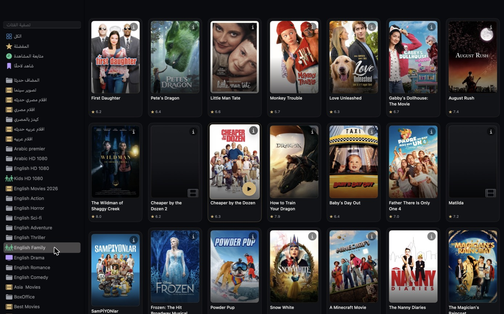

<div align="center" dir="rtl">

# صندوق الدنيا · SandokEldonia

**مشغّل IPTV أصلي لجهاز الماك.**<br>
Xtream Codes وM3U، شاشة رئيسية بصفوف ذكية، تقييمات، ملفات شخصية بوضع للأطفال، ومشغّل mpv مدمج.<br>
مجاني ومفتوح المصدر. بلا حسابات وبلا تتبّع.

[English](README.md)

</div>

<div dir="rtl">

صندوق الدنيا تطبيق ماك لمشاهدة القنوات المباشرة والأفلام والمسلسلات من مزوّد IPTV الخاص بك. هو نسخة مطوَّرة (fork) من المشروع المفتوح [IPTVMac](https://github.com/Goelir/IPTVMac) بواجهة داكنة جديدة وإضافات كثيرة (مذكورة أدناه). التطبيق مجرد مشغّل: **لا يحتوي** على أي قنوات أو أفلام أو مسلسلات ولا يستضيفها. تحتاج مصدرًا مسموحًا لك باستخدامه.

</div>



<sub>أفلام تصنيف واحد. النجمة تحت البوستر هي تقييم مزوّدك للعنوان، وزر ⓘ يفتح التفاصيل.</sub>

<div dir="rtl">

## التثبيت

يتطلب جهاز ماك بمعالج Apple Silicon (M1 أو أحدث) ونظام macOS 14 أو أحدث. لا شيء آخر للتثبيت: المشغّل (libmpv) داخل التطبيق.

1. نزّل ملف **SandokEldonia-1.1.1.zip** من [آخر إصدار](https://github.com/Elmo2030/SandokEldonia/releases/latest)، وانقر عليه مرتين، واسحب **SandokEldonia** إلى مجلد **Applications**.
2. افتحه من مجلد Applications. **في أول مرة سيرفض macOS فتحه** لأن هذه النسخة غير موثّقة (notarized) من أبل، وهذا يتطلب حساب مطوّر مدفوعًا. افعل أحد الآتي مرة واحدة:
   - **macOS 15 وما بعده:** حاول فتح التطبيق، ثم **System Settings > Privacy & Security** وانزل لأسفل واضغط **Open Anyway** بجوار SandokEldonia.
   - **الإصدارات الأقدم:** كليك يمين على التطبيق، اختر **Open**، ثم **Open** مرة أخرى.
   - **أو من Terminal** (يعمل في كل الإصدارات): `xattr -dr com.apple.quarantine /Applications/SandokEldonia.app`

بعدها يُفتح بنقرة مزدوجة عادية. هذه النسخة **لا تحدّث نفسها**؛ لتحديثها استبدله بنسخة أحدث. قوائمك ومفضلاتك وسجلّك تبقى كما هي (مخزّنة خارج التطبيق، انظر [بياناتك](#بياناتك)).

## أول تشغيل

يفتح التطبيق دليلًا قصيرًا لإضافة قائمة من مزوّدك:

- **Xtream Codes:** عنوان السيرفر (مثل `http://host:8080`) واسم المستخدم وكلمة المرور.
- **M3U:** اسم للقائمة ورابطها.

كل شخص يستخدم اشتراكه الخاص. مشاركة حساب واحد بين أشخاص قد تخالف شروط المزوّد، وكثير من المزوّدين يسمحون باتصال واحد فقط في الوقت نفسه.

## المزايا

**المكتبة والشاشة الرئيسية**
- قنوات مباشرة وأفلام ومسلسلات من Xtream Codes أو M3U، وعدة قوائم معًا أو **كل القوائم** في عرض واحد.
- **شاشة رئيسية** بصفوف: *أكمل المشاهدة*، *أُضيف حديثًا*، *مشابه لآخر عمل شاهدته*، و*المزيد من تصنيفه*.
- **أُضيف حديثًا:** عند التحديث تقارن القائمة بالسابقة وتخبرك كم فيلمًا ومسلسلًا جديدًا نزل. أول تحديث لقائمة هو نقطة الأساس فلا يُعدّ شيء جديدًا وقتها.
- زر **تحديث القوائم** في الشاشة الرئيسية وفي الشريط العلوي (⌘R).
- بحث نصي فوري في أكثر من 100,000 عنصر (داخل تصنيف أو قسم أو في كل مكان).
- **فلاتر** في تبويبي الأفلام والمسلسلات: إخفاء ما شوهد، الأحدث أولًا، حدّ أدنى للتقييم.
- **التقييم** تحت كل فيلم ومسلسل له تقييم، وفي شاشة التفاصيل. يأتي من بيانات مزوّدك؛ قوائم M3U لا تحمل تقييمات.
- قائمة **شاهد لاحقًا** (في الشريط الجانبي وبالكليك اليمين على أي عنوان)، والمفضلة.
- **شاشة تفاصيل** بالبوستر والقصة والممثلين والسنة والتقييم والمدة والإعلان لأفلام ومسلسلات Xtream (اضغط على البوستر؛ زر ⓘ ظاهر دائمًا).

**الأشخاص**
- **ملفات شخصية:** المفضلة وسجل المشاهدة وشاهد لاحقًا منفصلة لكل شخص، والقوائم مشتركة. حتى 8 ملفات.
- **ملف الأطفال:** يعرض فقط التصنيفات التي تبدو أسماؤها موجّهة للأطفال (kids، cartoon، family، أطفال، كرتون...). هذا تخمين من أسماء التصنيفات، فهو للراحة وليس ضمانًا.
- **رمز PIN** اختياري يُطلب عند مغادرة ملف شخصي يحمله. هو قفل للراحة وليس أمانًا.

**التشغيل**
- مشغّل [mpv](https://mpv.io) مدمج: فك ترميز بالعتاد، ترجمات ومسارات صوت (مدمجة أو ملفات `.srt`/`.ass` بالسحب والإفلات)، سرعة من 0.25x إلى 4x، مؤقت نوم، ملاءمة/ملء/تمديد.
- **صورة داخل صورة**، **Catch-up** (Xtream)، تحميل الأفلام والحلقات، استكمال من حيث توقفت، وعدّاد الحلقة التالية.
- **استعادة أذكى:** الأفلام والحلقات تعيد الاتصال بعد انقطاعه وتكمل قبل نقطة الانقطاع بلحظة؛ والقنوات المباشرة تعيد المحاولة بفواصل متزايدة. إن فشل التشغيل فزر **نسخ بيانات التشخيص** ينسخ اسم السيرفر ونوع الملف والخطأ، ولا ينسخ حسابك أو كلمة المرور أو الرموز أبدًا.
- **دليل البرامج:** البرنامج الحالي والتالي لقنوات Xtream، ولقنوات **M3U التي تذكر قائمتها رابط دليل** (`url-tvg`، XMLTV، عادي أو gzip).
- الصوت والكتم والحلقة/القناة التالية والسابقة من لوحة المفاتيح.

**أخرى**
- شريط تنبيه عند بقاء أسبوع أو أقل على اشتراك Xtream.
- نسخ احتياطي واستعادة للقوائم (بدون كلمات المرور) والمفضلة وسجل المشاهدة وشاهد لاحقًا (للملف الشخصي المستخدم).
- 31 لغة واجهة، مع اتجاه من اليمين لليسار للعربية والعبرية والفارسية والأردية. عدا العبرية والإنجليزية والعربية الأصلية، كُتبت الترجمات بمساعدة الذكاء الاصطناعي ولم يراجعها ناطقون أصليون.

## اختصارات لوحة المفاتيح

| أين | المفاتيح |
|---|---|
| في أي مكان | ⌘R تحديث القوائم · ⌘N إظهار النافذة |
| قائمة Playback | ⌘] الحلقة أو القناة التالية · ⌘[ السابقة · ⌥⌘M كتم · ⌥⌘↑ / ⌥⌘↓ الصوت |
| داخل المشغّل | Space إيقاف مؤقت · ← / → تخطّي · ↑ / ↓ الصوت · M كتم · N / P التالي / السابق · F ملء الشاشة · A ملاءمة / ملء / تمديد · 2 سرعة مضاعفة · [ / ] أبطأ / أسرع · Esc رجوع |

## بياناتك

القوائم والمفضلة والسجل والملفات الشخصية مخزّنة في `~/Library/Application Support/IPTVMac/` (مقروءة لمستخدمك فقط). كلمات مرور الحسابات محفوظة في قاعدة البيانات هذه كنص عادي وليس في Keychain. يتصل التطبيق بالسيرفرات التي تضيفها فقط (مزوّدك، ورابط الدليل الذي تذكره قائمة M3U). لا تحليلات ولا تتبّع. المجلد يحتفظ باسمه الأصلي `IPTVMac` ليقرأ التطبيق بيانات المشروع الأصلي.

## مهم أن تعرف

- التفاصيل وCatch-up والتقييمات وتاريخ الاشتراك تأتي من لوحات **Xtream**. قائمة **M3U** لا تحمل شيئًا منها؛ وقنواتها تحصل على دليل برامج فقط إذا ذكرته القائمة.
- العناوين "الجديدة" تُكتشف عبر معرّفات البث. إذا أعاد المزوّد ترقيم كتالوجه أو حمل رابط M3U رمزًا متغيرًا يتجاهل التطبيق تغييرًا بهذا الحجم؛ وقد تظهر قائمة صغيرة جدًا برابط متغيّر كأنها جديدة.
- أجهزة Intel وmacOS 13 أو الأقدم غير مدعومة.
- التحديث التلقائي مُطفأ في هذه النسخة (انظر [الحقوق](#الحقوق-والترخيص)).

## البناء من المصدر

تحتاج macOS 14+ وأدوات Xcode Command Line Tools وHomebrew مع `mpv` و`pkg-config`.

</div>

```
./scripts/swift.sh build -c release    # compile
./scripts/swift.sh test                # run the tests
./scripts/make-app.sh                  # assemble build/IPTVMac.app with the player bundled
```

<div dir="rtl">

يتوقع `make-app.sh` وجود أيقونة التطبيق في `~/Downloads/SandokEldonia.icns`؛ غيّر `CUSTOM_ICON` في السكربت إلى ملف `.icns` خاص بك أو عدّل السكربت لتخطيها.

## الحقوق والترخيص

صندوق الدنيا نسخة مطوَّرة (fork) من **[IPTVMac](https://github.com/Goelir/IPTVMac)** لصاحبه Goelir ومساهميه، ويحتفظ بترخيصه: **GPL-3.0** (انظر [LICENSE](LICENSE)). إن أعطيت أحدًا التطبيق فعليك أن تعطيه (أو تدلّه على) هذا الكود المصدري. مصادر iOS (`ios/`) وAndroid (`flutter/`) في هذا المستودع آتية من المشروع الأصلي و**لا** تتضمن التعديلات المذكورة أعلاه. الملفات تحت `docs/` (موقع المشروع وصفحة الخصوصية ولقطات الشاشة) تخص المشروع الأصلي ولا تصف هذا التطبيق.

مُحدِّث المشروع الأصلي مُطفأ هنا: فهو مرتبط بإصدارات المشروع الأصلي ومفتاح توقيعه، وبما أن معرّف التطبيق واحد فكان سيستبدل صندوق الدنيا بالتطبيق الأصلي. محرّك التشغيل هو [mpv](https://mpv.io) (libmpv، مدمج) بترخيصه الخاص.

</div>
